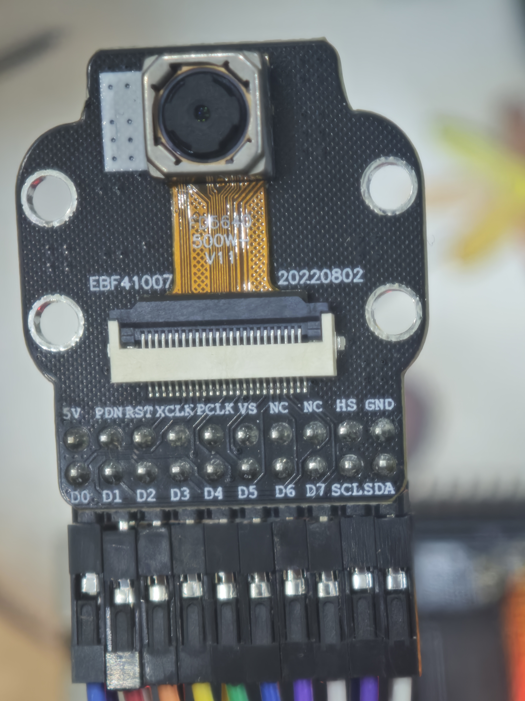
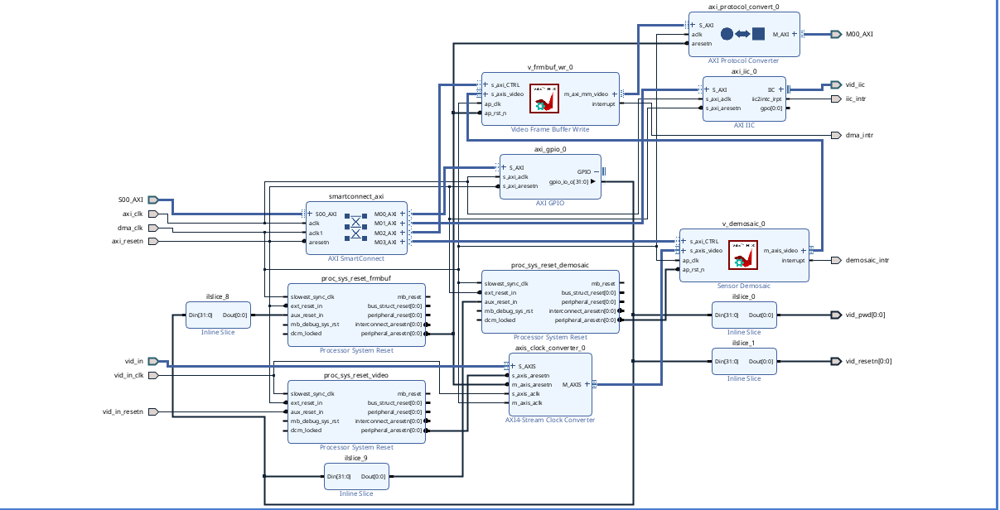

# OV5640 DVP Camera Project

This design demonstrate how to receive DVP camera stream with FPGA and how to use it with v4l2 on Linux.

It use OV5640 module from this [LAZADA LINK](https://s.lazada.vn/s.uc9mK?t=p-i3Xgqs2-sH4S3Bg).



You can use any DVP Camera module with RAW output.

# Vivado design



# FPGA pinout

This design use Zynq 7020 bank 33 for camera module.

Pinout on Smart Zynq 7020 board:

| GPIO | FPGA PIN | CAMERA PIN |
| --- | --- | --- |
| GPIO Pin 2  | GPIO_T22_L2P   | CAM_SCL  |
| GPIO Pin 4  | GPIO_V22_L3P   | CAM_SDA  |
| GPIO Pin 6  | GPIO_Y20_L9P   | CAM_PDN  |
| GPIO Pin 8  | GPIO_AA22_L7P  | CAM_RST  |
| GPIO Pin 10 | GPIO_AA21_L8P  | CAM_VS   |
| GPIO Pin 12 | GPIO_AB20_L10N | CAM_HS   |
| GPIO Pin 1  | GPIO_U22_L2N   | CAM_D0   |
| GPIO Pin 3  | GPIO_W22_L3N   | CAM_D1   |
| GPIO Pin 5  | GPIO_Y21_L9N   | CAM_D2   |
| GPIO Pin 7  | GPIO_AB22_L7N  | CAM_D3   |
| GPIO Pin 9  | GPIO_AB21_L8N  | CAM_D4   |
| GPIO Pin 11 | GPIO_AB19_L10P | CAM_D5   |
| GPIO Pin 13 | GPIO_AA19_L11N | CAM_D6   |
| GPIO Pin 15 | GPIO_AB16_L18N | CAM_D7   |
| GPIO Pin 17 | GPIO_Y18_L12P  | CAM_PCLK |

# How to build it?

See [BUILDING](BUILDING.md)

# How to test it?

## Setup camera stream

First, print the camera pipeline topology

```
media-ctl -p 
```

You will see something like this:

```
Media controller API version 6.12.40

Media device information
------------------------
driver          xilinx-video
model           Xilinx Video Composite Device
serial          
bus info        platform:vcap_CAMERA_SUB_v_demo
hw revision     0x0
driver version  6.12.40

Device topology
- entity 1: vcap_CAMERA_SUB_v_demosaic_0 ou (1 pad, 1 link)
            type Node subtype V4L flags 0
            device node name /dev/video0
        pad0: Sink
                <- "83c10000.v_demosaic":1 [ENABLED]

- entity 5: ov5640 0-003c (1 pad, 1 link, 0 routes)
            type V4L2 subdev subtype Sensor flags 0
            device node name /dev/v4l-subdev0
        pad0: Source
                [stream:0 fmt:UYVY8_2X8/640x480@1/30 field:none colorspace:srgb xfer:srgb ycbcr:601 quantization:full-range
                 crop.bounds:(0,0)/2624x1964
                 crop:(0,4)/2624x1944]
                -> "83c10000.v_demosaic":0 [ENABLED]

- entity 7: 83c10000.v_demosaic (2 pads, 2 links, 0 routes)
            type V4L2 subdev subtype Unknown flags 0
            device node name /dev/v4l-subdev1
        pad0: Sink
                [stream:0 fmt:SRGGB8_1X8/1280x720 field:none colorspace:srgb]
                <- "ov5640 0-003c":0 [ENABLED]
        pad1: Source
                [stream:0 fmt:RBG888_1X24/1280x720 field:none colorspace:srgb]
                -> "vcap_CAMERA_SUB_v_demosaic_0 ou":0 [ENABLED]
```

Setup media format:

```
media-ctl -V "'ov5640 0-003c':0 [fmt:SRGGB8_1X8/1280x720]"
```

You can list all media bus format with this command:

```
media-ctl --known-mbus-fmts
```

Setup video format (output format):

```
v4l2-ctl --set-fmt-video=width=1280,height=720,pixelformat=BGR3
```

Note: v4l2-ctl by default using /dev/video0 device. You can specify different device with `--device=` parameter.

You can list video formats supported with this command:

```
v4l2-ctl --list-formats
v4l2-ctl --list-formats-ext
```

## Stream test

After camera stream setup complete, you can test camera stream with:

```
v4l2-ctl --stream-mmap
```

Or, you can output camera stream to file:

```
ffmpeg -f v4l2 -pix_fmt bgr24 -i /dev/video0 output.mkv
```

Or, view it with framebuffer device (like HDMI):

```
ffmpeg -f v4l2 -pix_fmt bgr24 -i /dev/video0 -f fbdev /dev/fb0
```

Some framebuffer device use diffrent format, ie rgb565le, use this command:

```
ffmpeg -f v4l2 -pix_fmt bgr24 -i /dev/video0 -pix_fmt rgb565le -f fbdev /dev/fb0
```
