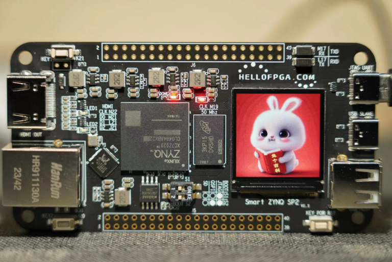
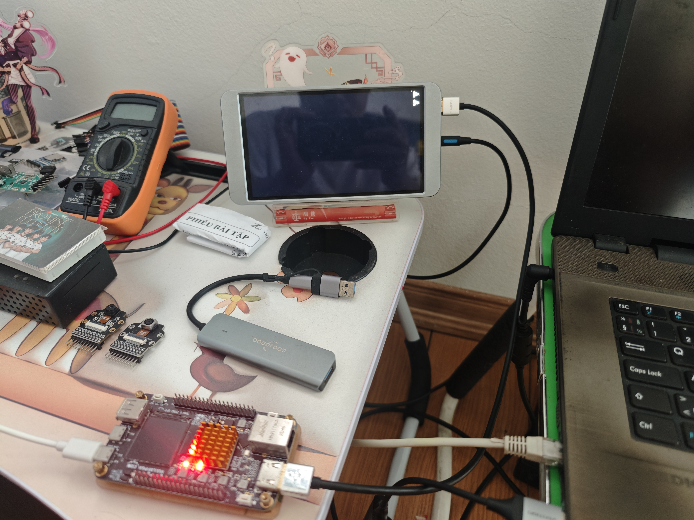
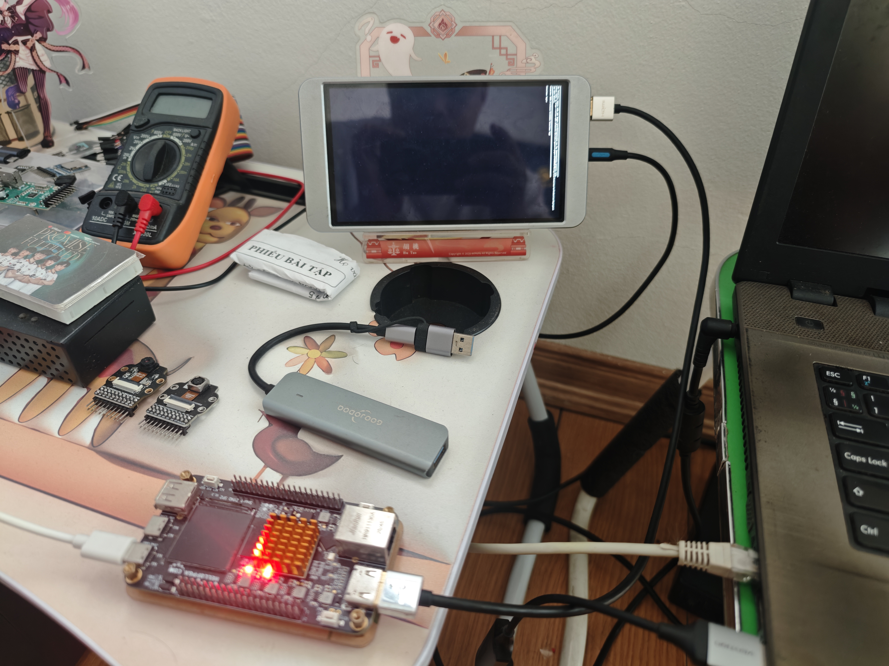
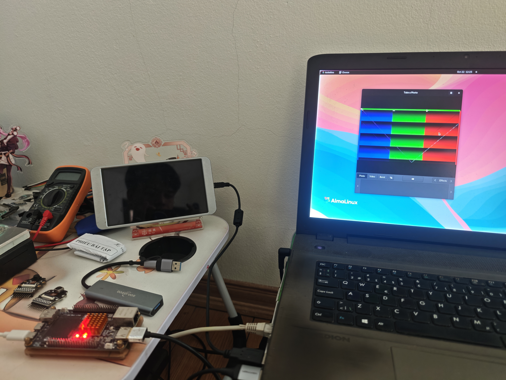

# Smart-Zynq-SP2 Full Flow Project
This project is a playground for Smart-Zynq-SP2 dev board.

**Board homepage:** http://www.hellofpga.com/index.php/2024/01/21/smart-zynq-sp2/

# What it have?

This project contains full flow to building hardware and software from Vivado to Petalinux. With integration to Makefile and some necessary scripts, this project allow easy way to maintain and develop.

**Flow has been tested on Vivado 2025.2, PetaLinux 2025.2 on AlmaLinux 9/10.**

It can:

- Bootup from JTAG/SD card
- Hearbeat LED
- Play with SPI Mini Display
- Play with Gigabit Ethernet
- Play with HDMI at max Full HD (1920x1080)

- Play with OV5640 camera with max IO frequency 100MHz

# How to build?

See [BUILDING](BUILDING.md)

# Little bit about design

See [DESIGN](DESIGN.md)

# Licence and copyright

BSD 3-Clause. Copyright (c) 2026, Van Linh (Ljnk975@gmail.com). See [LICENSE](LICENSE).
